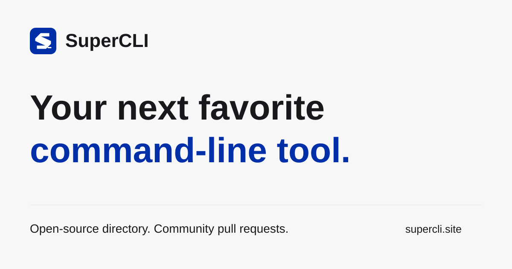

<p align="center"></p>
<h1 align="center">SuperCLI</h1>
<p align="center"><strong>发现值得装进终端的工具 · 社区提交，公开维护。</strong></p>
<p align="center"><a href="LICENSE"></a> </p>

[English](README.en.md) · [网站](https://supercli.site) · [贡献指南](CONTRIBUTING.md) · [参考项目](docs/RESEARCH.md)

| 需求                    | SuperCLI                          |
| ----------------------- | --------------------------------- |
| 找云厂商、AI 与终端工具 | 用途分类 + 搜索 + 厂商筛选        |
| 知道排名依据            | GitHub 仓库 Stars + 明确快照时间  |
| 收藏自己的常用工具      | 分享带筛选条件的 URL              |
| 贡献工具                | GitHub PR，本地人工核验后手动合并 |

首批收录 90 个工具，包含 Cloudflare Wrangler、腾讯云 CLI、阿里云 CLI。使用官方项目组织或维护者头像，提供官方文档和安装命令。

## 快速开始 / Quick start

```sh
git clone git@github.com:webkubor/supercli.git
cd supercli
pnpm install --frozen-lockfile
pnpm dev
```

需要 Node 24+、pnpm 12.4；访问终端显示的本地地址。`pnpm build` 包含类型检查、数据校验和行为回归测试。

## 数据和部署

`data/catalog.json` 是收录真源；`data/metrics.json` 是 GitHub API 快照。`pnpm sync` 刷新指标，`node scripts/sync.mjs --gh --icons` 使用本机 gh 刷新指标和官方组织头像。

Cloudflare Pages 项目名 `supercli`。如需使用手动 Actions 发布，在 GitHub production 环境配置 `CLOUDFLARE_API_TOKEN`，必须包含目标账号的 Pages 编辑权限。PR 不自动审核；由维护者本地核验后手动合并与发布，本地手动刷新；无定时任务。

Stars 代表仓库关注度，monorepo 指标覆盖整个仓库，不代表 CLI 使用量。商标与图标归各权利人。本站为独立社区。

[产品](PRODUCT.md) · [设计](DESIGN.md) · [交互](EXPERIENCE.md) · [图标来源](docs/ICONS.md) · [变更记录](CHANGELOG.md)

[PR 人工审核机制](docs/REVIEW.md)：本地核验、人工审核、手动合并，首期不运行自动化审核。

## 配置与故障排查

[配置参考](docs/CONFIGURATION.md) · [FAQ](docs/FAQ.md) · [安全政策](SECURITY.md) · [AI 协作规范](AGENTS.md)

项目手动检查使用 `pnpm test`、`pnpm typecheck`、`pnpm build`。GitHub 的 Manual project checks 只在维护者手动触发时执行基础校验，不审核或批准 PR。
